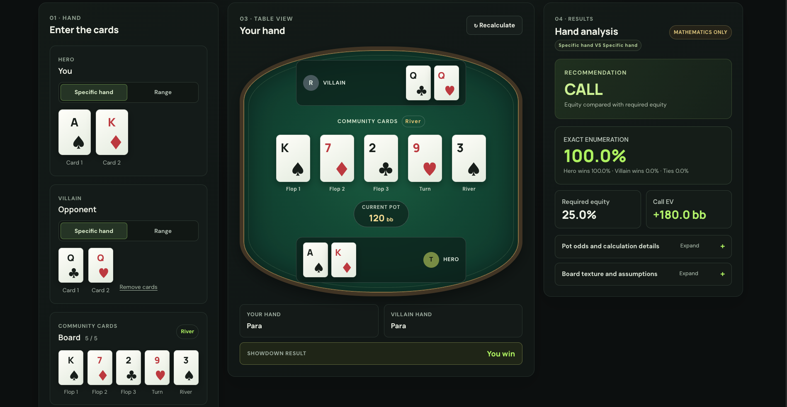
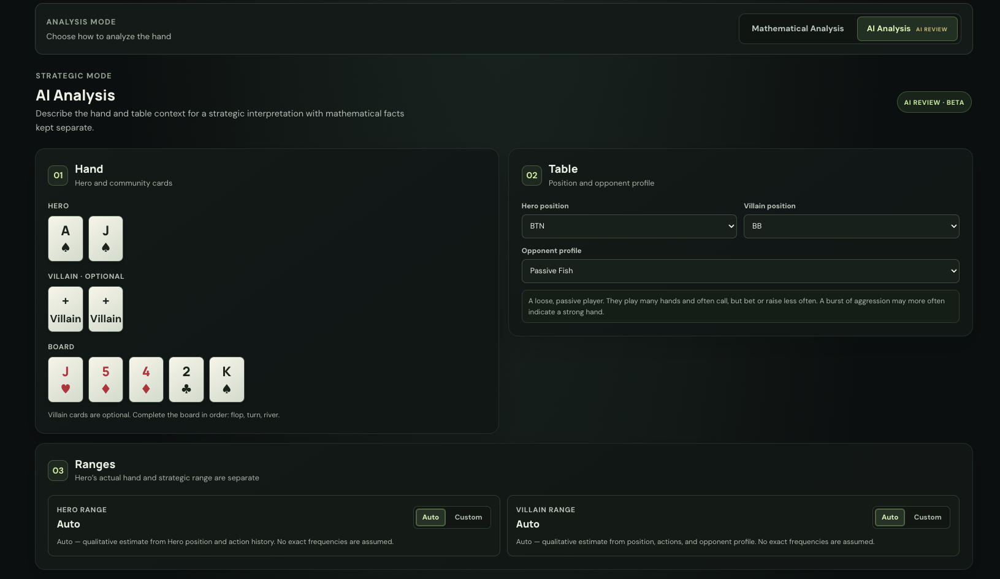
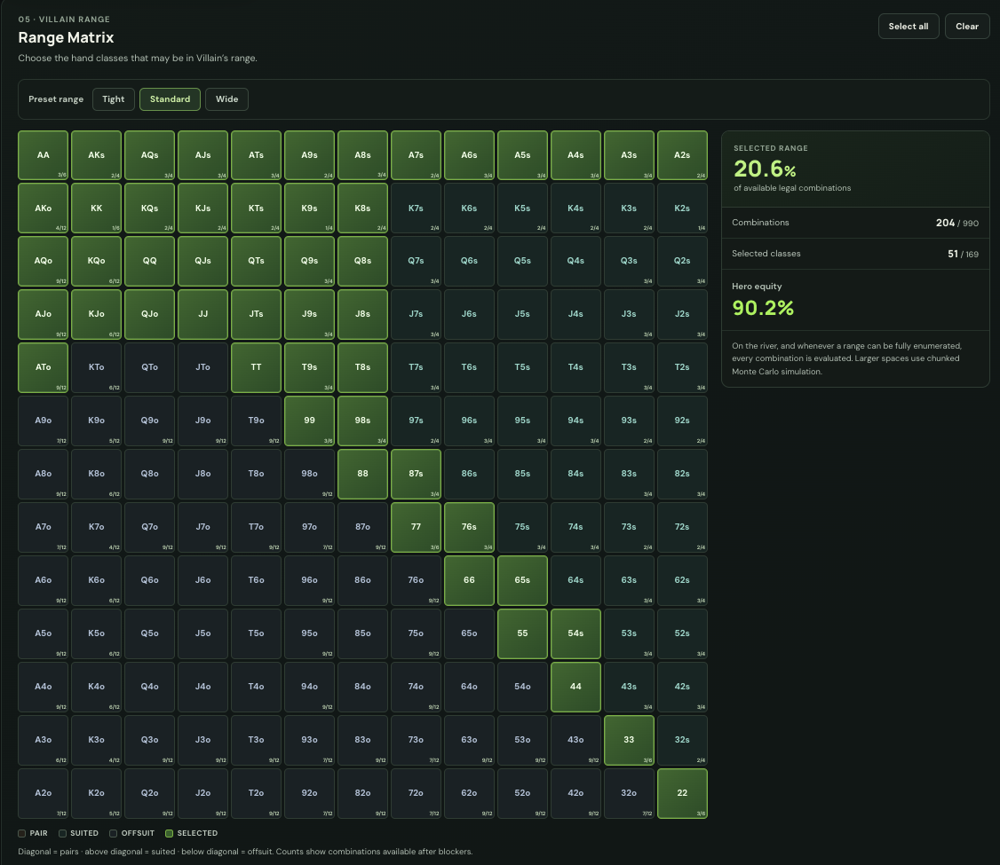
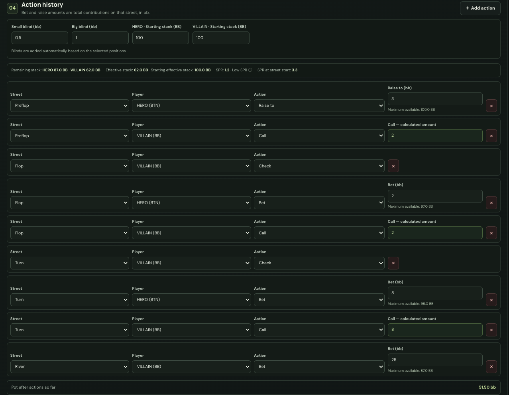
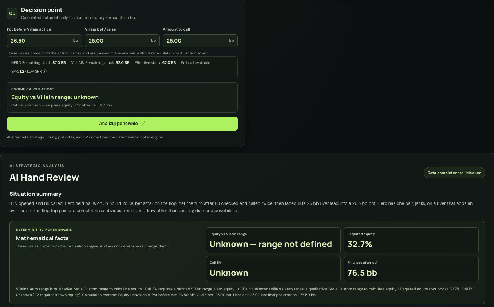
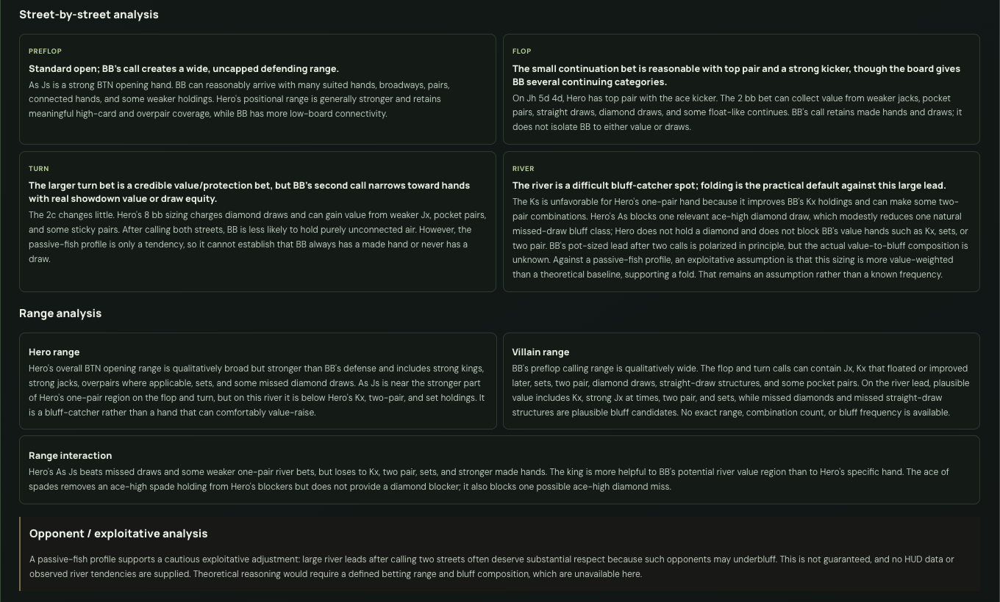
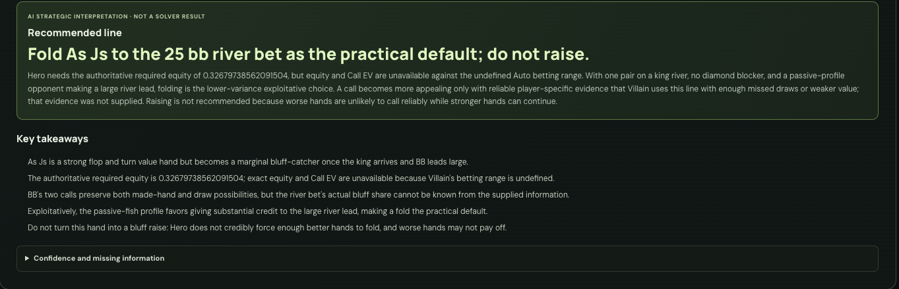

# Poker Hand Analyzer

**A full-stack Texas Hold’em analysis tool that keeps poker math deterministic and AI commentary in its place.**

Build a hand, explore equity and pot odds, model action and stack state, then request an optional structured AI review.

> **The math is not generated by AI.** Hand evaluation, equity, pot odds, and call EV come from the application’s poker engine. AI review provides contextual commentary; it is not a GTO solver and can be wrong.

## Product screenshots

### Mathematical Analysis

Poker table with Hero and Villain cards, exact equity, pot odds, and a CALL recommendation.

### AI Analysis setup

Hand and board selection, player positions, opponent profile, and range settings.

### Range Matrix

13×13 starting-hand matrix with selected classes, blocker-adjusted combinations, and Hero equity.

Explore More Screenshots

### Action History

Street-by-street actions with starting and remaining stacks, effective stack, and pot size.

### AI Hand Review

Decision point, situation summary, and mathematical facts shown separately from AI commentary.

### Street-by-street Analysis

AI commentary on preflop, flop, turn, and river play, plus range and opponent analysis.

### Recommended Line & Key Takeaways

AI recommendation and takeaways for the illustrated river decision.

See the [screenshot inventory](docs/screenshots/README.md) for asset descriptions.

## Key features

- **Visual hand entry:** select Hero, Villain, and board cards; duplicate-card validation prevents impossible combinations.
- **Mathematical Analysis:** evaluate hand strength and board texture, compare known hands or ranges, and inspect wins, losses, ties, equity, required equity, and call EV.
- **13×13 Range Matrix:** choose pair, suited, and offsuit classes individually or with presets. Physical combinations are generated correctly and removed when blocked by known cards.
- **Exact and estimated equity:** enumerate all legal outcomes when practical; otherwise run chunked Monte Carlo simulation. The interface identifies the method and reports the number of cases or simulations.
- **Action and stack tracking:** record street-by-street actions and positions, starting and remaining stacks, all-ins, effective stack, automatic street progression, and SPR.
- **AI Poker Analysis:** request a structured review using positions, action history, ranges, opponent profile, optional player statistics, stack state, and language.
- **Polish and English:** localized interface and AI responses. Changing the interface language does not silently submit a new AI request.
- **Demo hand:** load an example to explore the mathematical workflow.

## How it works

### Mathematical Analysis

The in-project poker evaluator ranks Hold’em hands from high card through straight flush, including kickers, ties, and the wheel straight. Range classes expand into physical card combinations: a pair has six, a suited class four, and an offsuit class twelve before blockers.

Known cards are removed from the available deck. When the complete legal outcome space is within the engine’s exact-enumeration bound, every legal runout is evaluated. Larger spaces use Monte Carlo sampling without replacement, processed in chunks to keep the interface responsive. Estimates can vary between runs.

Pot odds and EV use the following definitions:

- **Final pot after call** = current pot + Villain’s bet + Hero’s call.
- **Required equity** = Hero’s call ÷ final pot after call.
- **EV(call)** = equity × final pot after call − Hero’s call.

The recommendation follows the resulting call EV: positive supports a mathematical call, negative supports a fold, and values close to zero are approximately break-even. It does not account for future betting, rake, or opponent behavior.

### AI Poker Analysis

When the user explicitly requests a review, the browser sends the supplied hand context to a server-side Next.js route. The route validates the request, applies usage controls, and calls the OpenAI Responses API using Structured Outputs.

The server rejects incomplete provider responses and validates the returned fields before display. Mathematical context shown with the review is derived from the validated input, not accepted from model-generated prose. AI commentary can be incomplete or mistaken; it does not calculate equity or EV and does not promise an optimal strategy.

## Technical architecture

~~~mermaid
flowchart LR
    Browser[Browser UI Next.js and React] --> Math[Poker engine hand evaluation, ranges, equity, pot odds, EV]
    Browser -->|User-requested review| Gate[Server access gate]
    Gate --> Validate[Input validation]
    Validate --> Limit[Shared usage controls]
    Limit --> Provider[Server-side AI provider]
    Provider --> Schema[Structured response validation]
    Schema --> Browser
    Limit --> Redis[(Upstash Redis)]
    Provider --> OpenAI[OpenAI Responses API]
~~~

The browser owns hand entry and deterministic calculations. The server handles AI requests, protects provider credentials, enforces request checks and shared usage controls, and validates the structured response before returning it to the UI.

## Engineering highlights

- **Poker logic is separated from presentation:** hand evaluation, range generation, blockers, equity, call calculations, and action-state replay live in dedicated modules.
- **Range combinatorics are card-based:** range classes expand into legal physical combinations; Hero and board cards remove blocked combinations.
- **Responsive equity work:** exact enumeration is preferred within a bounded case space; chunked Monte Carlo is used for larger calculations.
- **Action-state validation:** action history, stacks, all-ins, effective stack, and SPR are represented and checked before AI review.
- **Strict AI response handling:** the provider response must be complete and match the expected structured fields before rendering.
- **Safe server boundaries:** AI and Redis credentials stay server-side. Production AI analysis uses shared rate limiting and fails closed if that control is unavailable.
- **Testable provider integration:** automated tests use a mocked provider and do not require paid API calls.

The deployed project currently has a temporary HTTP Basic Authentication access gate. These protections are useful controls for the current deployment, not a replacement for accounts, identity-based quotas, or a formal security review.

## Getting started

### Requirements

- Node.js 20 or later
- npm

### Install and run

~~~bash
npm install
cp .env.example .env.local
~~~

Set a random local value for DEPLOYMENT_ACCESS_SECRET before starting; the access gate requires it. Add OPENAI_API_KEY only if you want to use AI Poker Analysis. Keep both values in the untracked .env.local file and never use a NEXT_PUBLIC_ prefix for secrets. The mathematical features work without an OpenAI key.

~~~bash
npm run dev
~~~

Open [http://localhost:3000](http://localhost:3000). At the local access prompt, use access as the username and the configured secret as the password.

### Environment variables

| Variable | Required for | Description |
| --- | --- | --- |
| OPENAI_API_KEY | AI review | Server-side credential for the OpenAI Responses API. |
| OPENAI_MODEL | Optional | Model selection; defaults to gpt-5.6-terra. |
| UPSTASH_REDIS_REST_URL | Production AI review | Shared Redis REST endpoint used by production usage controls. |
| UPSTASH_REDIS_REST_TOKEN | Production AI review | Server-side credential for the shared Redis limiter. |
| DEPLOYMENT_ACCESS_SECRET | App access | Server-side secret required by the temporary access gate. |

The example environment file contains placeholders only. Configure production values in the hosting provider’s server-side environment settings. Never commit .env.local or expose credentials in browser code, screenshots, logs, or support material.

### Tests and quality checks

~~~bash
npm test
npm run lint
npm run typecheck
npm run build
~~~

Tests use Node’s built-in test runner. They cover hand rankings and equity, ties and edge cases, ranges and blockers, action and stack state, request validation, language handling, structured response validation, and rate limiting. AI provider calls are mocked.

### Deployment overview

The app is designed for a standard Next.js deployment on Vercel:

1. Import the repository as a Next.js project.
2. Configure the server-side environment variables for AI review, shared production usage controls, and the temporary access gate.
3. Confirm the hosting plan supports the route execution configuration and that platform access controls are enabled.
4. Build and deploy through the platform, then verify the protected application and API behavior.
5. Keep provider usage alerts and platform-level protections enabled.

The access gate is temporary preview protection, not a complete account system. Before removing it or opening the app publicly, establish an appropriate authentication and usage model and review production controls.

## Limitations and roadmap

### Current limitations

- AI commentary can be incomplete or inaccurate. It is not solver output or guaranteed advice.
- Auto opponent ranges are qualitative assumptions, not exact probability distributions.
- Arbitrary per-combination range weights are not supported.
- Monte Carlo results are estimates and can vary between runs.
- The mathematical model does not cover multiway pots, rake, tournament ICM, or future betting trees.
- The temporary access gate and IP-based usage controls do not provide durable user accounts or per-user quotas.

### Possible next steps

- Add durable accounts and user-level usage controls.
- Support weighted ranges and more game formats.
- Extend the mathematical model with rake, multiway pots, and tournament ICM.

---

Built as an independently developed full-stack portfolio project.
